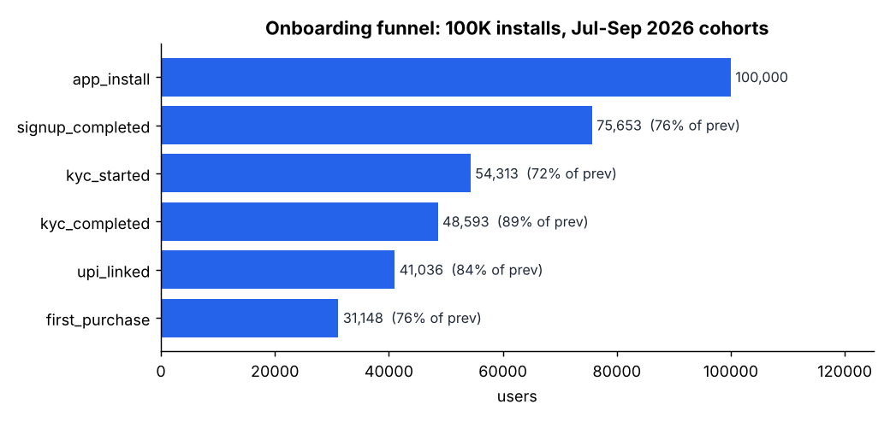
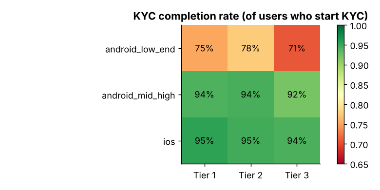
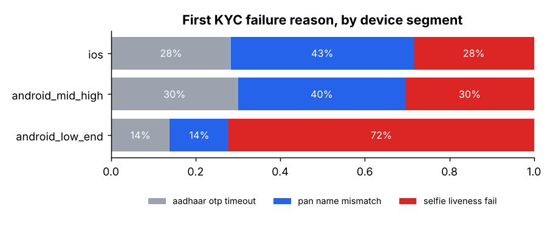
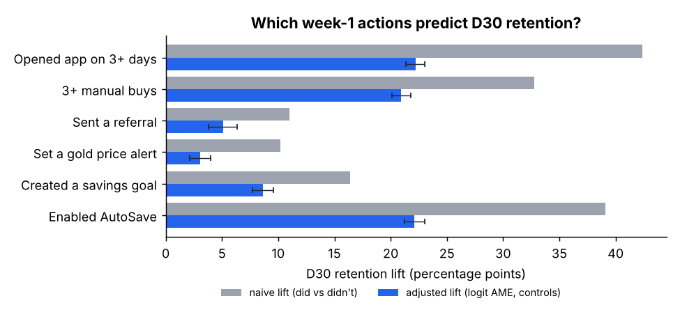
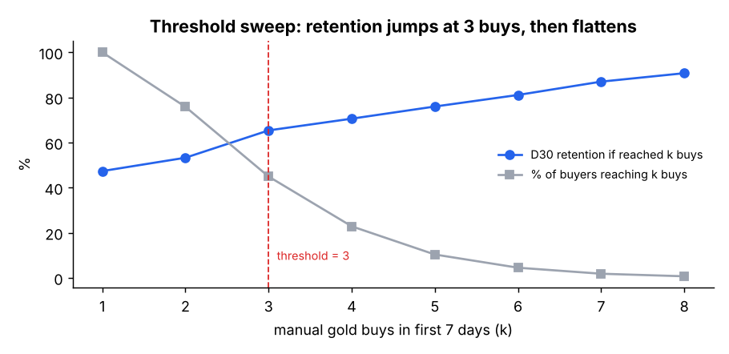
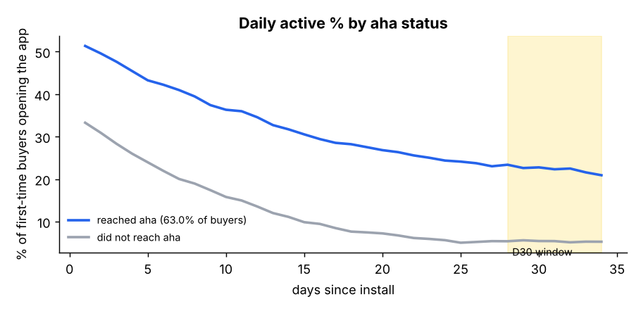

# AhaFinder: Activation & Aha-Moment Analytics for a Savings App

**Product analytics case study** on 1.07M events from 100K users of *Sona*, a fictional digital-gold micro-savings app (think UPI + daily AutoSave). It answers the two questions every growth PM asks:

1. **Where do we lose users between install and first purchase, and what is fixing it worth?**
2. **What do users who stay do differently in week 1, and can we design onboarding around it?**

> **Data note.** The dataset is **simulated**. `src/generate_data.py` builds it with realistic behaviour (intent-driven confounding, device-specific KYC failures, decaying engagement), so every number below is reproducible with one command. The value of the project is the method: tracking plan → SQL marts → funnel diagnosis → confounding-aware aha-moment analysis → sized recommendations and an experiment plan.

**Stack:** Python (pandas, statsmodels, scikit-learn) · SQL on DuckDB (staging → intermediate → marts) · Streamlit + Plotly · pytest

---

## Headline findings

| | Finding |
|---|---|
| 🔻 **Funnel leak** | Only **31.1%** of installs make a first purchase. KYC completion is **73.5% on low-end Android vs 94.0%** for everyone else. That segment is 22.1% of KYC starters but **50.1% of KYC failures**, and **72%** of its failures are selfie/liveness checks. |
| 💰 **Sized opportunity** | Closing half the low-end Android KYC gap adds **~787 first-time buyers per quarter (+2.5%)** and **~373 D30-retained savers**. |
| ✨ **Aha moment** | **AutoSave enabled OR 3+ manual buys in week 1.** Buyers who reach it have **63.3% D30 retention vs 20.1%** for those who don't (**3.1×**). It covers 63% of buyers and captures **84%** of all retained users. |
| 🧪 **Confounding check** | Price alerts *look* like a +10.2 pp retention driver, but after adjusting for other behaviours and user mix the effect is only **~+3.0 pp**. It's a vanity feature, so deprioritise it. |
| ✅ **Validation** | Model trained on Jul-Aug cohorts and tested on the September cohort: **AUC 0.818**. The aha split holds out of time (63.2% vs 19.7%). |
| 📐 **Next experiment** | AutoSave prompt after the first purchase. Detecting +2 pp D30 needs **9,800 buyers per arm (~8 weeks)**. |

Full write-up: [`docs/product_memo.md`](docs/product_memo.md) · Metric tree: [`docs/metric_tree.md`](docs/metric_tree.md) · Tracking plan: [`docs/tracking_plan.md`](docs/tracking_plan.md)

---

## Charts

| | |
|---|---|
|  |  |
|  |  |
|  |  |

---

## How the aha moment was chosen (and why not just "highest lift")

1. **Candidate actions** in the first 7 days: AutoSave, savings goal, price alert, referral, N manual buys, N active days.
2. **Naive lift** compares retention for users who did each action against those who didn't. This is biased: motivated users do *everything*.
3. **Adjusted lift** comes from a logistic regression with all behaviours plus channel, city tier, device segment and language. Each coefficient is converted to an **average marginal effect in percentage points** with a 95% CI. Price alert and goal creation shrink the most, so their naive lift was mostly "who" rather than "what".
4. **Threshold sweep** for manual buys (k = 1…8) plots retention-if-reached against coverage. The biggest marginal jump is **2 → 3 buys (+12.1 pp)**, then gains flatten to about +5 pp per extra buy. **3 is the knee.**
5. **Actionability filter.** "Opened app on 3+ days" predicts as well as AutoSave, but it's an *outcome* of engagement, not an action the product controls. It was excluded.
6. **Out-of-time check** on the Sep cohort, then a **randomised test** before claiming causality.

---

## Project structure

```
├── src/
│   ├── generate_data.py     # simulated event log (100K users, 15 event types)
│   ├── build_marts.py       # runs SQL models in DuckDB
│   └── analyze.py           # funnel, KYC, sizing, aha discovery, validation → charts + results.json
├── sql/
│   ├── 01_staging.sql               # typed views, day-since-install
│   ├── 02_int_user_funnel.sql       # first timestamp per onboarding step
│   ├── 03_int_week1_behaviour.sql   # candidate aha actions
│   ├── 04_int_retention.sql         # D7 / D30 (user-initiated activity only)
│   ├── 05_mart_user_activation.sql  # one row per user, analysis-ready
│   └── 06_analysis_queries.sql      # named queries used by analyze.py
├── app/dashboard.py         # Streamlit: funnel, KYC deep-dive, aha explorer with filters
├── tests/test_data_quality.py  # 7 checks: uniqueness, funnel order, no pre-install events…
├── docs/  (product_memo.md, metric_tree.md, tracking_plan.md)
└── outputs/ (charts/, results.json, aha_candidates.csv, buy_threshold_sweep.csv)
```

## Run it

```bash
pip install -r requirements.txt
python src/generate_data.py --users 100000 --seed 42   # ~15 s
python src/build_marts.py
python src/analyze.py
pytest -q
streamlit run app/dashboard.py
```

The data tests caught a real bug during development: the generator could timestamp a purchase *before* UPI was linked. `test_step_order_in_time` now guards against it.
